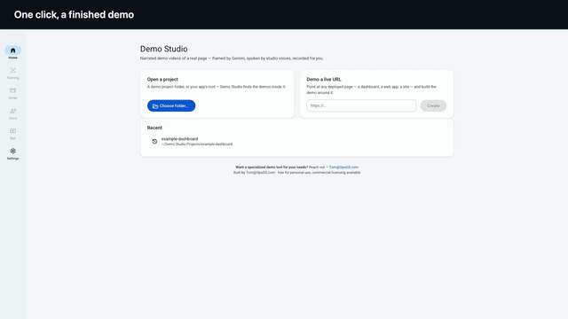

# Demo Studio

Turn any web page into a narrated product demo video — the framing, the
studio voiceover, and the edit handled for you. Point it at a page, tell it
the story, press Run.

[](https://github.com/Automating-my-Job/Demo_Studio/releases/download/v0.1.0/app-tour.mp4)

*▲ 20-second preview. [Watch the full 60s cut with voiceover](https://github.com/Automating-my-Job/Demo_Studio/releases/download/v0.1.0/app-tour.mp4) —
produced by Demo Studio, about itself, driving its own UI. Or grab the app
from [Releases](https://github.com/Automating-my-Job/Demo_Studio/releases/latest) and make your own.*

**Two ways to use it:**
- **With an AI agent** — hand this repo to your coding agent. [AGENTS.md](AGENTS.md)
  is written for it: the demo grammar, the director's loop, and the worked
  example in [`demos/app-tour`](demos/app-tour). Your agent directs; the
  engine records, voices, and cuts.
- **With the app** — a macOS application with Gemini auto-framing, an
  editable shot list, voice sampling, and one-click runs. Build it with
  `npm install && npm start`.

The demo above was produced by this tool, about itself, driving its own
UI — real clicks, real recording, no screen capture, no editor. Its
project file is [`demos/app-tour/demo.json`](demos/app-tour/demo.json).

**How many hours does your team spend on a single product demo?**
**Want a specialized demo tool for your needs? Reach out — [Tom@OpsGS.com](mailto:Tom@OpsGS.com).**

Built by Tom@OpsGS.com. **Free for personal use.** For commercial use
(client work, inside a business, bundling into a product), please reach
out — see [LICENSE](LICENSE).

Directing a demo (or building the tool's next capabilities)? Read
[AGENTS.md](AGENTS.md) — the director's loop that produced the app-tour
demo, the upgrades it forced, and the backlog for automating the loop.

## Running it

**Download:** grab `Demo-Studio-macOS-arm64.zip` from
[Releases](https://github.com/Automating-my-Job/Demo_Studio/releases/latest),
unzip, drag to Applications. The app is unsigned (no Apple Developer ID),
so the first launch is right-click → **Open** → Open.

**Or build from source:**

```bash
npm install        # once
npm run dev        # vite renderer w/ HMR + Electron
npm start          # production build + Electron
npm test           # unit tests (node --test)
```

The recording/narration pipeline is the **demo-suite engine bundled at
`vendor/demo-suite`** — the runner `require()`s its lib files by path.
If you hack on the engine in a separate folder, point Settings at your
copy (the field's empty default means "use the bundled engine").

## How it fits together

```
src/renderer   React + @material/web (Material 3). The ONLY part vite touches.
src/preload    contextBridge → window.demoStudio. The renderer's whole world.
src/main       Plain CJS Electron main: window, IPC, settings (safeStorage-
               encrypted keys), studio-media:// protocol, job manager.
runner/        Plain CJS pipeline child process — forked per job, detached
               (cancel = SIGTERM to the process group, so Chrome/ffmpeg die
               too). Emits JSON events over fork IPC; under bare node it
               prints them as JSON lines: node runner/runner.js --job=x.json
shared/        demo.json schema/validation, event constructors, voice
               catalogs, the condensed AGENTS.md framing rules.
```

Two kinds of project:

- **Studio project** — a folder with a `demo.json` (narration + shot list +
  target). The generic executor (`runner/executeShots.js`) maps shots onto
  the recorder's `rec` primitives. Created by the app (live-URL flow,
  scaffolding) or by hand; Gemini framing writes into it.
- **Classic project** — a folder with its own `build.js`/`storyboard.js`
  (the demo-suite engine's original hand-written format). Run as
  `node build.js --engine=… --voice=…` with output streamed into the app.

## demo.json in one breath

```jsonc
{
  "target":  { "kind": "url|html|render", "url": "…", "readySelector": ".app" },
  "camera":  { "pageSelector": ".demo-page" },
  "record":  { "width": 1920, "height": 1080, "fps": 60, "stallMs": 5000 },
  "voice":   { "engine": "google", "voice": "en-US-Chirp3-HD-Charon" },
  "instructions": "what story the demo tells (feeds Gemini framing)",
  "narration": [ { "key": "__HOOK__", "text": "…" } ],          // order = clip order
  "shots":     [ { "id": "s1", "action": "frame", "subject": { "selector": ".x", "nth": 1 } } ]
}
```

Actions: `say frame spot spotOut crawl click type waitForVo atVo hold settle
caption cta resetCamera run`. Hand-editing is a first-class path: `null`
entries are skipped, `"disabled": true` keeps a shot in the file but out of
the cut, unknown keys survive round-trips.

## GitHub share kit

Demo Studio can prepare a clean, local handoff for a demo-only GitHub
repository. Add `githubShare` to a Studio project's `demo.json`, or add a
`github-share.json` file beside `build.js` in a classic project:

```json
{
  "repository": "https://github.com/OWNER/DEMO_REPOSITORY",
  "title": "Product — Demo",
  "description": "Demo video for Product.",
  "summary": "A short, outcome-focused product summary.",
  "features": ["First viewer takeaway.", "Second viewer takeaway."],
  "availability": "Publishing soon. Free for pilot customers who provide feedback."
}
```

After a successful run, `demo-out/github-share/repository/` contains only a
short `README.md` and the upload-safe MP4 under `demo/`. The README links to
GitHub's raw-file route because the ordinary blob page may decline to preview
an MP4 even when the file is small. `github-description.txt` stays one level
above the repository folder for copying into GitHub's About field.

This feature never signs in to GitHub, stores credentials, creates a
repository, or publishes anything. Review the generated copy and video before
you upload them.

## Live apps (Salesforce Setup and other real sites)

`runDemo` films a real, signed-in app when you turn on its live options:

- `frames: true`: follows every frame, including cross-site iframes, and accepts subjects by visible label: `rec.click({ text: 'Manage Assignments' })`, `rec.type({ text: 'Quick Find' }, 'Permission Sets')`.
- `cursor: true`: a pointer glides to each target and clicks for real; typing sends real keystrokes at about 10 characters a second.
- `rec.beat(key, { say })`: one sentence per beat; the labels it quotes must be on screen. Run once with `dryRun: true` (the wording preflight) before filming.
- `rec.redact(pairs, { maskEmails: true })` and `rec.audit(where)`: display-only redaction in every frame, and a never-show audit that must read zero.
- After filming: `frameScan.js` reads every frame (on-device OCR) and `preflight.js`'s `wordDiff` checks the narration word for word.

AGENTS.md §2 lists each piece and why it exists; §5 has the Salesforce traps.

### Capture once, compose offline

For marketing-grade output, film the app once and render the rest:

- `runDemo(board, { frames: true, capture: { dir } })` runs the storyboard like the preflight and saves `rec.still(key, { subjects })`: lossless 2x stills below the band, each with its subject boxes, taken only after the never-show audit reads zero, then OCR'd.
- `renderComposition({ captureDir, timeline, voManifestPath, words, aspect })` renders the film: a neutral canvas, a camera that pushes in on each subject as its word is spoken, a soft ring, an arcing cursor with click ripples, short kinetic titles (Google Sans Flex), one hook and end card, and a stereo master at -16 LUFS with a ducked music bed. `aspect` is `16:9`, `1:1` or `9:16`, all from the same capture.
- A timeline is data: per narration line, the still, a title of at most 8 words, and moves such as `{ focus: 'row', word: 'late' }` or `{ click: 'tab', then: 'next-still', word: 'shows' }`.
- Music is a slot: pass `bed: { file }` with a track you have licensed. Without one the bed is silent. Never commit a track.

## Keys

Settings encrypts keys with the macOS keychain (Electron `safeStorage`) and
injects them into pipeline children as `GOOGLE_TTS_KEY` / `GEMINI_TTS_KEY` —
which `narrate.js` checks before the `~/.google_tts_key` / `~/.gemini_tts_key`
dotfiles, so app keys win and dotfile users (incl. multi-key rotation, which
is dotfile-only) keep working when the app fields are left empty. One Gemini
key serves both framing and the (discouraged) Gemini TTS engine, which
always runs the mlx-whisper verification — that check cannot be turned off.

## Rules inherited from demo-suite (do not relax here)

- Audio first; the picture is timed to the voice.
- Spotlight, never crop.
- The `stallMs` dead-air failure is real; fix the storyboard, don't raise it.
- Always ship the `-linkedin.mp4` (limited-range BT.709) encode, never the raw master.

## E2E checks

```bash
# full auto pipeline on the checked-in fixture (free, offline, ~1 min)
node runner/runner.js --job=<(echo '{"kind":"run-auto","projectDir":"'$PWD'/test/fixtures/static-page","demoSuitePath":"'$PWD'/vendor/demo-suite","userDataDir":"/tmp/ds-e2e"}')
```
